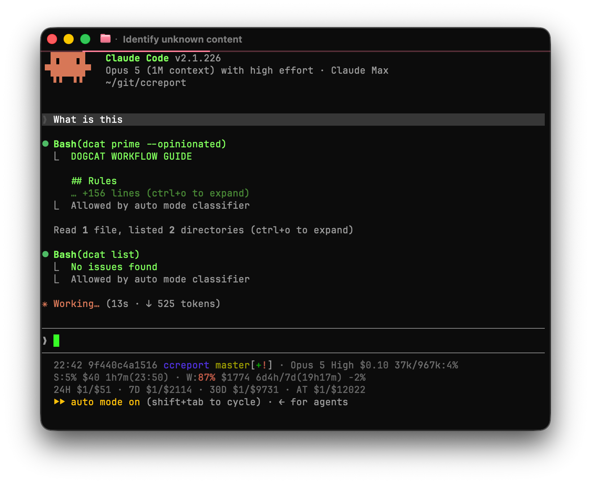
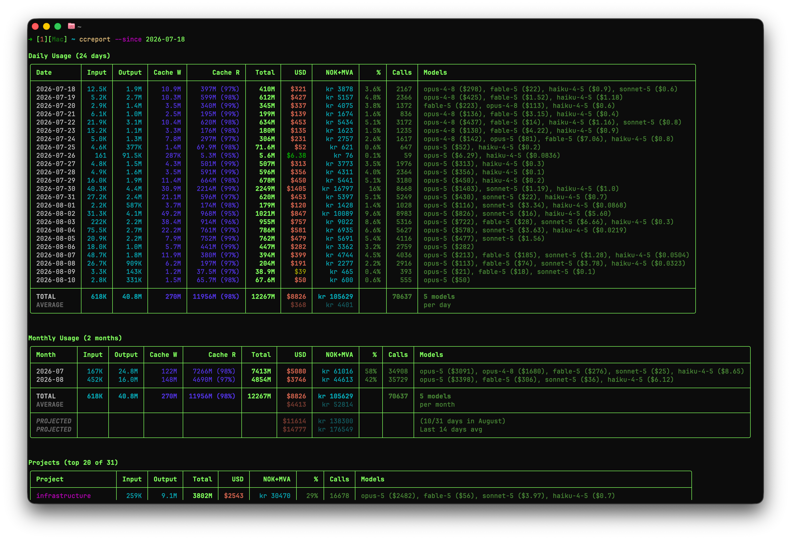
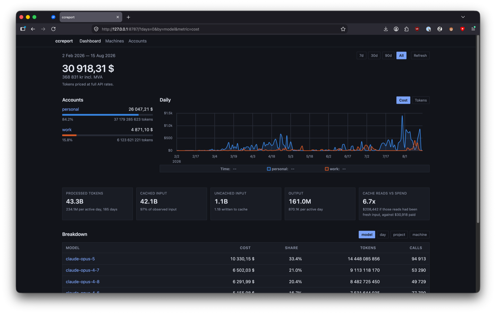

# ccreport

Token usage and cost reporting for Claude Code, Codex and OpenCode, plus a Claude Code
quota dashboard and status line: three commands over one cache.

`ccreport` and the status line work off the JSONL session logs Claude Code
already writes under `~/.claude/projects/` (or `~/.config/claude/projects/`).
The reports also read Codex rollouts under `$CODEX_HOME/sessions/` and
`$CODEX_HOME/archived_sessions/`; `CODEX_HOME` defaults to `~/.codex`.
OpenCode reports read its local SQLite database under
`$XDG_DATA_HOME/opencode/` (default `~/.local/share/opencode/`).

## Install

```bash
brew install oroddlokken/tap/ccreport
```

That puts `ccreport`, `ccu`, `ccreport-statusline` and `ccreport-quota-guard`
on `PATH`. The four shell wrappers `settings.json` points at ship beside the
package rather than on `PATH`, because a hook takes a path and not a command;
`ccreport scripts` prints them, one per line, the status line's first.

Every `/path/to/ccreport/bin/...` below is one of those lines on a wheel
install and the checkout's own `bin/` otherwise. Editing the modules wants a
clone; see [Install from a checkout](#install-from-a-checkout).

## Status line



Model, context fill, session and weekly quota, cost windows, git state.

Segments are toggled with `CLAUDE_STATUSLINE_*` environment variables, `1` on
and `0` off. The full list, with defaults, is the module docstring of
`src/ccreport/statusline.py`.

`settings.json` can name `ccreport-statusline` directly, and every segment then
renders at its module default. `bin/statusline-command_x.sh` reads each toggle
as `${VAR:-default}` instead, so a wrapper of your own that exports them and
hands over wins. Keep that wrapper outside the checkout and your settings
survive every `git pull`:

```bash
#!/usr/bin/env bash
# ~/.claude/statusline-wrapper.sh — chmod +x

export CLAUDE_STATUSLINE_HOSTNAME=1
export CLAUDE_STATUSLINE_DOGCAT=1
export CLAUDE_STATUSLINE_SCOPED_MODE=always

# "$@" carries the arguments Claude Code passes; the JSON arrives on stdin,
# which exec leaves alone.
exec bash /path/to/ccreport/bin/statusline-command_x.sh "$@"
```

Point Claude Code's `settings.json` at that wrapper:

```json
{
  "statusLine": {
    "type": "command",
    "command": "bash /path/to/statusline-wrapper.sh"
  }
}
```

The status line imports nothing outside the stdlib, so any `python3` runs it;
it works before `uv sync` has. Quota percentages are refreshed by a detached
process, so a fresh reading lands on a later render.

### The hooks

Two per-session files under `TMPDIR` hold what a render learned, and two hooks
drop them when what they hold has changed. Both need `jq`:

```json
{
  "hooks": {
    "SessionStart": [
      {
        "hooks": [
          {
            "type": "command",
            "command": "bash /path/to/ccreport/bin/clear-statusline-memo.sh"
          }
        ]
      }
    ],
    "ConfigChange": [
      {
        "hooks": [
          {
            "type": "command",
            "command": "bash /path/to/ccreport/bin/clear-statusline-cache.sh"
          }
        ]
      }
    ]
  }
}
```

`clear-statusline-memo.sh` deletes the memo, whose
`--dangerously-skip-permissions` verdict comes from the argv of the claude
process that launched the session id. `--resume` reuses that id under new argv,
and `SessionStart` takes no matcher — it fires on startup, resume, clear,
compact and fork alike, which is every moment that verdict can change.

`clear-statusline-cache.sh` deletes the fetch cache, which holds the `sbx`/`!sbx`
badge and the segments the `CLAUDE_CODE_STATUSLINE_*` toggles switch on for 15
seconds. Both are read out of settings files, so `ConfigChange` is what puts an
edit on the next render rather than 15 seconds later. It leaves the memo in
place: the DSP verdict is not a settings reading.

Neither hook prints anything — a `SessionStart` hook's stdout is appended to the
session's context — and both exit 0 on anything they cannot parse. Exit 0 does
double duty in the `ConfigChange` one: exit 2 there blocks the settings change
itself.

### The quota guard

`bin/quota-guard.sh` stops a session before it crosses into extra usage. Point
the hooks at the wrapper rather than at `ccreport-quota-guard`: the arming gate
below is in the wrapper, and this runs before every tool call. Wire it to both
events; the verdict is the same for either, and only which turn it halts
differs:

```json
{
  "hooks": {
    "UserPromptSubmit": [
      {
        "hooks": [
          {
            "type": "command",
            "command": "bash /path/to/ccreport/bin/quota-guard.sh"
          }
        ]
      }
    ],
    "PreToolUse": [
      {
        "hooks": [
          {
            "type": "command",
            "command": "bash /path/to/ccreport/bin/quota-guard.sh"
          }
        ]
      }
    ]
  }
}
```

Wiring it arms nothing. `CCQUOTA_STOP` does, and the hook exits before any
interpreter starts while it is unset, so a session without it pays one bash
spawn per prompt. The environment is read at launch, which makes a launcher the
way to use it:

```bash
alias claude-capped='CCQUOTA_WARN=85 CCQUOTA_STOP=95 claude'
```

The 5-hour and weekly windows take lines of their own, and every window without
one stays on the global pair:

```bash
CCQUOTA_WARN_SESSION=89 CCQUOTA_STOP_SESSION=99 \
CCQUOTA_WARN_WEEK=75    CCQUOTA_STOP_WEEK=85    claude-capped
```

`CCQUOTA_STOP` is still the whole switch — a per-window variable on its own arms
nothing. Sonnet and the scoped model limit have no override; the global pair
covers them. `ccap` in the macsetup checkout wraps this as `-s` and `-w`, each
taking the stop percentage and deriving its warn ten points below.

Over the warn line, one `systemMessage` lands per window instance rather than
per prompt. Over the stop line the hook answers `continue: false`, which halts
the turn and leaves the session open for input — `UserPromptSubmit` before the
prompt reaches the model, `PreToolUse` at the next tool call of a turn already
running. No hook can exit the CLI, and the reason reaches you rather than
Claude.

Hook input carries no quota data, so the readings come from what a render
stored: the stdin S/W percentages in a per-session `TMPDIR` file, and Sonnet and
the scoped model limit from the usage row. Each source is trusted for as long as
its own cadence: 15 minutes for the stdin reading a slow render writes, an hour
for the API-only quotas, whose fetch the render skips while nothing on the line
needs them. Where two sources disagree the fuller reading wins.

An unknown reading blocks, and the message names `CCQUOTA_STOP` as the way out —
unset it and relaunch. A quota the API nulls because the plan does not have it
is a different answer: not applicable, and not watched. A machine with no usage
row at all reads as unknown and blocks every prompt, so arm the guard on
machines whose status line is running.

The quota is per account; this stops the sessions on this machine that carry the
variable, and nothing else.

## ccreport



```bash
ccreport                                    # every report, all history
ccreport daily --since 20260201 --breakdown
ccreport monthly
ccreport project --limit 10
ccreport session --limit 10
ccreport model --tool codex                 # model, tokens and API value
ccreport model --tool opencode              # OpenCode models and token usage
ccreport tool                              # totals by tool
ccreport daily --tool claude                # select one tool
ccreport --tool codex --json                # local calls, including reasoning metadata
ccreport limits -w session                  # rate-limit window history
```

Interactive local reports show a temporary status while updating logs. When
the last index is unknown or at least a day old, a matching saved report appears
with its date, followed by the updated report. Warm runs, JSON and pipes show
only the final report. The saved report (`report-preview.json`) and startup
timings (`startup-timings.json`) live beside `cache.db`, normally in
`~/.local/share/ccreport/`. `ccreport --debug` also prints timings to stderr;
see the [calculation reference](docs/calculation-reference.md#13-interactive-report-startup-and-diagnostics)
for details.

Costs are priced per record from a pricing table in `src/ccreport/pricing.py`,
deduplicated by the log's own `message.id`/`requestId`, and grouped into
projects by git remote, then repo-root path, then directory name. A rename the
rules cannot see needs a manual rule:

```bash
ccreport overrides
ccreport merge company company-platform  # company's records report as company-platform
ccreport unmerge company
```

Codex calls appear in the same reports as Claude Code. The reader counts each
`token_usage_record` once by response ID, including subagents and automatic
reviews; the cumulative `token_count` events alongside them are not additional
calls. Cached input is shown separately from ordinary input, and reasoning is
already part of output. JSON preserves the reasoning count, originating tool,
thread ID and logged account ID.

Codex costs are **API Standard value estimates**, not an account bill or a
subscription quota calculation. A `*` marks a partial cost total when some calls
have no verified price; wholly unpriced rows say `unpriced`, and JSON uses
`null` for those calls. `codex-auto-review`
keeps its logged model name and remains unpriced because its underlying model
has not been established. Usage before a model's verified pricing period is
also unpriced. Cache hits have a discounted API value, not a guarantee of free
subscription usage. See the [Codex calculation notes](docs/calculation-reference.md#11-codex-usage).

ChatGPT accounts come from the rollout's `creator_account_id`. Older calls
without it appear as `Codex – unknown account`; current login credentials are
not used to assign historical usage. Legacy rollouts with only `token_count`,
and calls with nonzero cache-write counts whose accounting is not yet verified,
are explicitly reported as unsupported. A missing turn context also produces
a diagnostic when model attribution needs a fallback.

`ccreport archive` retains Codex history as individual cached calls so future
price and attribution corrections remain possible. Push/server reports can
include Codex calls with known account and pricing, but Codex pull into local
`-A` reports is not supported yet. Use the server's reports for combined Codex
usage across machines. The status line, `ccu`, quota guard and `limits` continue
to use Claude Code data only.

OpenCode imports each completed `step-finish` once, keeping provider and model
metadata. SQLite is authoritative when present; the older `storage/` JSON
files are read only when the database is absent. Forked history is excluded
using the original message time, while new calls in forks and subagents count
normally. Cached input stays separate, and OpenCode's separate reasoning
count is included in output exactly once.

OpenCode costs use ccreport's API valuation where a verified price exists.
The original logged cost is retained separately: a logged zero does not prove
free usage and never overrides the API estimate. Models without a verified
rate remain `unpriced`. Accounts appear as `OpenCode – unknown account`;
provider names and current credentials cannot establish who paid for an old
call, so these records remain local and are not automatically pushed.

The supported OpenCode storage format is V1 `message`/`part` data. A database
containing V2 `session_message` data is reported as unsupported and leaves
previously cached usage intact. OpenCode request-speed and quota reporting are
not available. Import diagnostics appear as short notes after the report;
`--tool` limits those notes to the selected tool. JSON stdout stays machine-readable.
See the [OpenCode calculation notes](docs/calculation-reference.md#12-opencode-usage).

### Leaving a tool out

`sources` in `~/.config/ccreport/ccreport.toml` names the tools this machine
reads. Unset, it is all three; Claude Code is always on whether it is listed or
not:

```toml
sources = ["claude"]            # no Codex, no OpenCode
```

A tool left out is not looked for, so its logs are not parsed, and every report
and push leaves out what the cache already holds for it. Those rows are hidden
rather than deleted, so putting the name back brings the history back,
including sessions whose logs have since rotated away. A file the server
already holds stays there; set `CCREPORT_SERVER_SOURCES` on the server to leave
it out of the merged reports too. If `allow`, `exclude` or the restriction
changed while a tool was off, run `ccreport server push --full` after putting it
back: its files missed the re-push that change triggered, and the server keeps
the names it had.

## ccu

The quota dashboard, the same numbers as Claude Code's `/usage` screen, from
the same endpoint, cached for up to ten minutes:

```bash
ccu             # session, week, per-model and Extra quotas
ccu --force     # bypass the 10-minute cache
ccu --json      # the raw API body, unrendered; always a live fetch, never cached
```

The week gets a pace line comparing usage against elapsed time.
`CLAUDE_CODE_PACE_DAYS` sets the day the quota is meant to be gone by, counting
from whichever weekday the window starts on. It defaults to 7, and both this
and the status line's pace segment answer to it.

## The dashboard



One machine runs a server and every machine pushes its records to it, so the
dashboard reports spend across all of them. The server prices each record with
its own copy of the pricing table rather than trusting what arrived.

```bash
just serve      # http://127.0.0.1:8787
```

`CCREPORT_SERVER_DB`, `_HOST`, `_PORT`, `_NETWORKS` and `_MAX_BODY` configure
it; there is no config file. `_NETWORKS` defaults to loopback and gates the web
UI alone — a machine pushes from wherever it happens to be, and its token is
what admits it.

Mint a token under `/settings/machines`. That page shows it once, inside the
command that consumes it:

```bash
ccreport server connect http://host:8787 --token TOKEN
ccreport server status                      # what each server knows this machine as
ccreport server push                        # the status line also pushes on its own interval
ccreport --server http://host:8787          # the merged reports, in the terminal
```

The token and the push policy land in `~/.config/ccreport/push.toml` at mode
0600. `--opt-in-repos work,ccreport` restricts that policy to the named
projects: every other project still sends its counts, but its name, session,
cwd and repo are stripped before the push and report as one aggregated row per
account. `--exclude-repos kantine` is the other direction, and needs no
restriction: those projects are stripped into the same aggregated row while
every other project keeps its name. `ccreport server allow` and `deny` edit the
first list afterwards, `exclude` and `unexclude` the second.
`--interval-minutes 5` sets how often the status line's detached push
runs; the default is 30. A metered link wants a longer interval, a wired desktop
a shorter one.

### The published image

A `vX.Y.Z` tag is what builds `ghcr.io/oroddlokken/ccreport:X.Y.Z` and
`:latest`, for `linux/amd64`. The image runs one worker and no reloader:

```bash
docker run -p 8787:8787 -v ccreport-data:/data \
  -e CCREPORT_SERVER_DB=/data/server.db \
  -e CCREPORT_SERVER_NETWORKS='127.0.0.1/32 192.168.0.0/16' \
  ghcr.io/oroddlokken/ccreport:latest
```

`_NETWORKS` has to name the range a browser arrives from. Inside docker that
is the bridge gateway rather than loopback, so the default answers every page
403.

`CCREPORT_SERVER_SOURCES=claude` (comma- or space-separated, Claude Code always
included) is the server's half of `sources`. Ingest skips every file from
any other tool and acknowledges it, so a client that still sends one does not
retry it. The rows an earlier push stored stay in the database and drop out of
every page and report until the name is put back.

## Install from a checkout

```bash
git clone git@github.com:oroddlokken/ccreport.git && cd ccreport
uv sync
```

Then put `bin/` on `PATH`, or install the CLI on its own:

```bash
uv tool install .
```

Every wrapper in `bin/` runs the modules out of the checkout rather than an
installed copy, so an edit takes effect on the next invocation.

## Updates

Homebrew is the update route the tools can name, so it is the one they report
on:

```
brew upgrade oroddlokken/tap/ccreport
```

The status line says when that is worth running, on a line under the cost
windows:

```
↑ ccreport v0.2.0 is available, run 'brew upgrade oroddlokken/tap/ccreport' to update
```

Twice a day a detached process asks GitHub's API for the newest release tag and
compares it against the installed version. The request never happens on the
render path. Set `CLAUDE_STATUSLINE_UPDATE=0` to turn the line and the request
off.

A checkout, a `uv tool install` and a bare wheel each update by a route this
cannot name, so none of them checks at all — a checkout pulls, and the other two
are reinstalled by whoever put them there.

The line goes quiet the moment you upgrade, rather than waiting for the next
check: the stored tag is tied to the version it was compared against.

## Where the data lives

| Path | What |
|---|---|
| `~/.local/share/ccreport/cache.db` | Parsed records, costs, usage row, rate-limit samples |
| `~/.local/share/ccreport/snapshots/` | One daily copy of the above, 14 kept |
| `~/.config/ccreport/ccreport.toml` | Optional `repo_roots` for project grouping, `sources` for which tools to read |

Not `~/.cache`, despite the file's name: the archive, the account log, the
rate-limit samples and the push watermarks are not rebuildable from the session
logs, and a cleanup sweep over `~/.cache` would take them. `XDG_DATA_HOME`
overrides the first two paths, `XDG_CONFIG_HOME` the third.

The DB used to sit in `~/.cache/ccreport`, and all three under `macsetup/claude`
names before that. Any command migrates them for itself on the first run that
finds no DB where it now belongs:

```bash
ccreport migrate --dry-run
ccreport migrate
```

## Development

`just --list` prints every recipe. `just test` runs the suite, `just lint-all`
runs ruff and pyright, `just fmt` applies ruff's autofixes but deliberately not
`ruff format`; see `AGENTS.md` for why.

Detailed calculations, cache schema and the reasoning behind the cost windows:
`docs/calculation-reference.md`.
